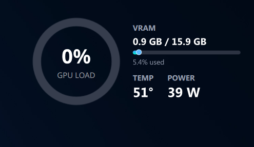

# GPU Monitor — KDE Plasma 6 widget



Minimal transparent GPU monitor for the KDE Plasma 6 desktop. Shows a GPU-load
ring, VRAM usage, temperature and power draw — nothing else.

Auto-detects **AMD** (reads sysfs directly, no extra tools), **NVIDIA** (via
`nvidia-smi`) and **Intel** GPUs.

Tested on: CachyOS, Plasma 6.7, AMD Radeon RX 9070 (discrete `card1`) +
Radeon 610M (integrated `card0`).

## Requirements

- KDE Plasma 6
- `python3`

## Install

```bash
git clone https://github.com/tobioffice/plasma-gpu-monitor.git
cd plasma-gpu-monitor
bash install.sh
```

Then add the widget:

1. Right-click the desktop or panel → **Add or Manage Widgets…**
2. Search **GPU Monitor** → **Add**

If the widget doesn't show up in the list, restart the shell (or log out and
back in):

```bash
kquitapp6 plasmashell && kstart plasmashell
```

## What it shows

Desktop card (transparent, floats on the wallpaper):

- Ring gauge: GPU load % with `GPU LOAD` label
- `VRAM`: used / total with usage bar and percent
- `TEMP` and `POWER`

Panel icon (when added to a panel instead): mini ring with load % and
temperature.

## Settings

Right-click the widget → **Configure**:

| Option | Default | Meaning |
|---|---|---|
| GPU card | `auto` | `auto` picks the discrete GPU. Set `card0`, `card1`, … to watch a specific one |
| Update every | `2 s` | Refresh interval, 1–10 seconds |
| Panel: show temperature | on | Show temp next to the % in the panel icon |

Tip: add the widget twice with different cards to watch discrete and
integrated GPUs at the same time.

## Check detection manually

```bash
python3 ~/.local/share/plasma/plasmoids/com.murali.gpumonitor/contents/code/gpu_stats.py --card auto | python3 -m json.tool
python3 ~/.local/share/plasma/plasmoids/com.murali.gpumonitor/contents/code/gpu_stats.py --card card1 | python3 -m json.tool
```

## How it works

`contents/code/gpu_stats.py` reads the GPU and prints one JSON line:

- AMD: `/sys/class/drm/card*/device/gpu_busy_percent`, `mem_info_vram_*`,
  `hwmon` (`temp`, `power`, `fan`, `freq`) — no extra packages needed
- NVIDIA: `nvidia-smi --query-gpu=…`
- Intel: `gpu_busy_percent` + GTT memory

`contents/ui/main.qml` runs the script every N seconds through the
`executable` data engine (`Plasma5Support.DataSource`) and feeds the QML
gauges. On multi-GPU systems `auto` picks the card with the most VRAM.

## Files

```
metadata.json                  widget id: com.murali.gpumonitor
screenshot.png
install.sh                     copies the widget into ~/.local/share/plasma/plasmoids/
contents/
  code/gpu_stats.py            data backend, outputs JSON
  ui/main.qml                  polling + shared state
  ui/CompactRepresentation.qml panel icon (mini ring + % + temp)
  ui/FullRepresentation.qml    desktop card (ring + VRAM + TEMP/POWER)
  ui/components/RingGauge.qml  donut gauge with glow
  config/main.xml              settings definition
  config/config.qml            settings page
```

## Update

```bash
cd plasma-gpu-monitor
git pull
bash install.sh
```

Then remove and re-add the widget (or restart `plasmashell`) so Plasma picks
up the new files.

## Uninstall

Remove the widget from your desktop/panel first, then:

```bash
rm -rf ~/.local/share/plasma/plasmoids/com.murali.gpumonitor
```
